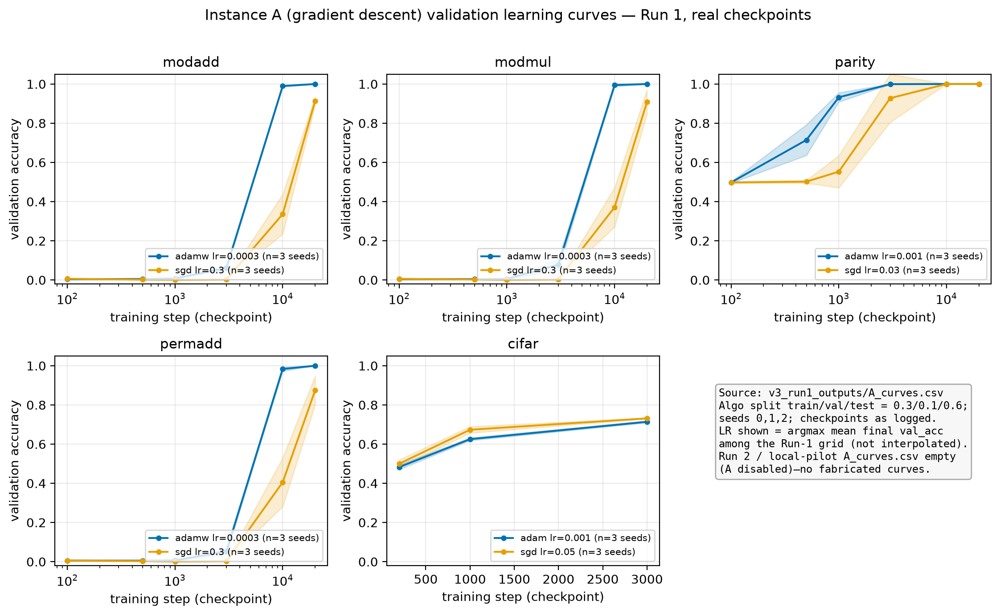
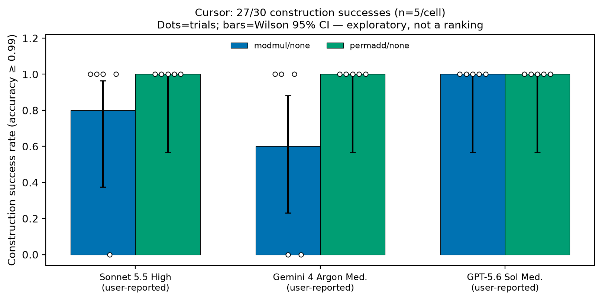
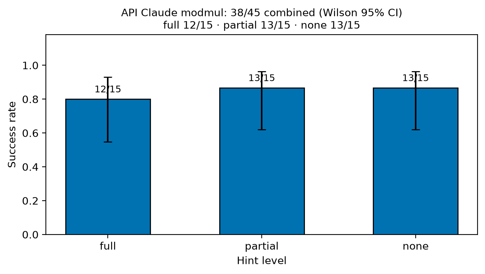
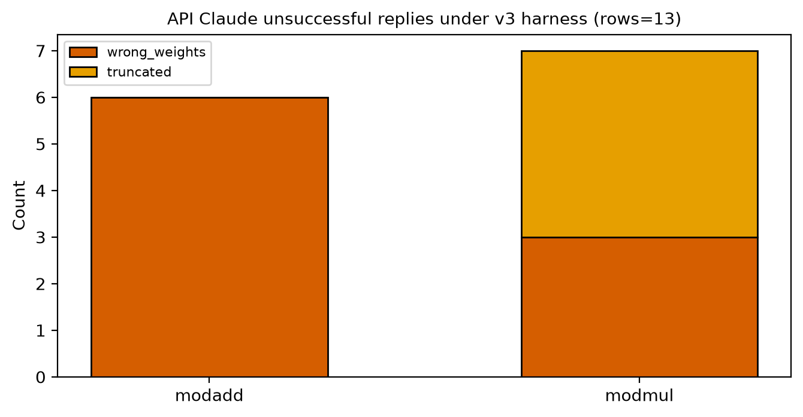
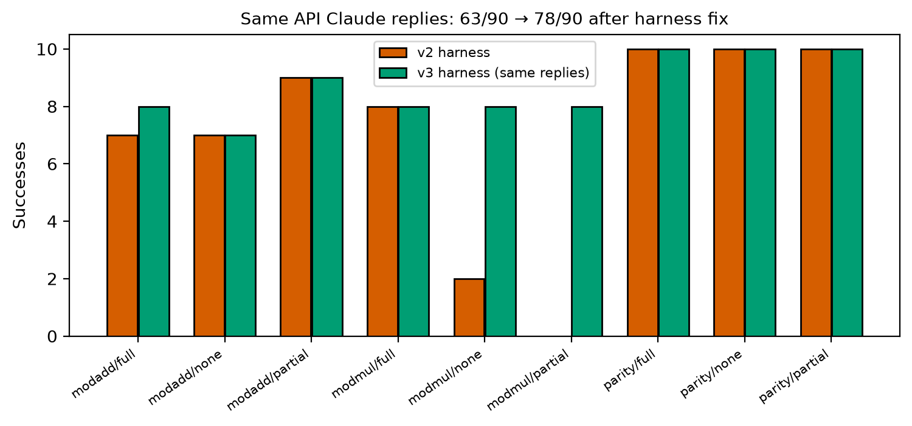
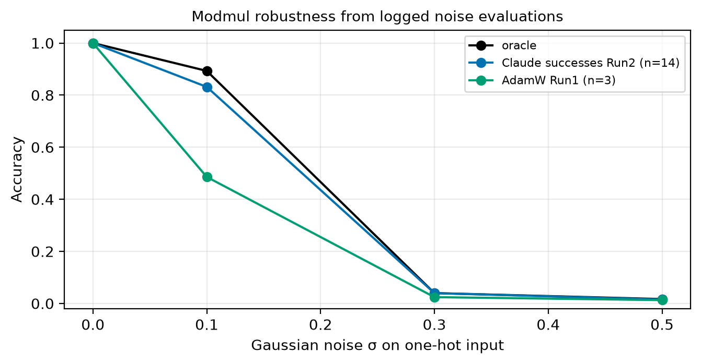
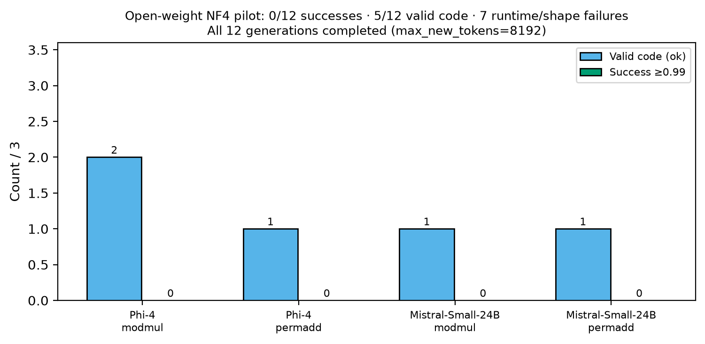
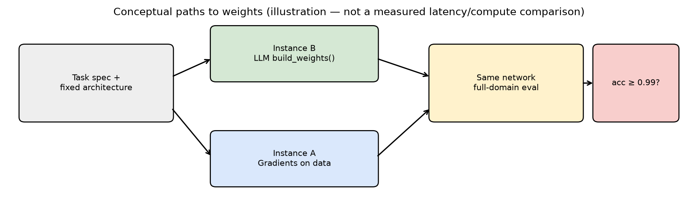
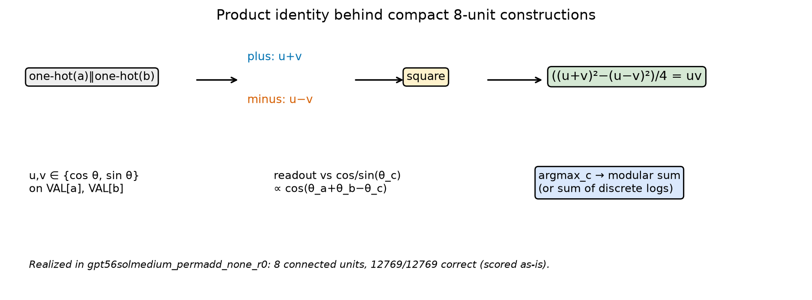
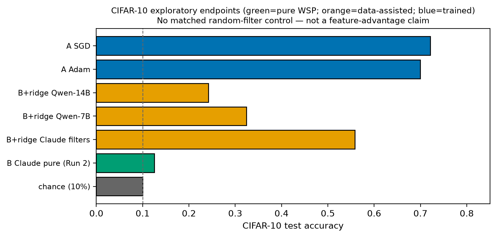

**REVIEW MANUSCRIPT v3 — PRE-PUBLICATION** (built 7 Nov 2026, Asia/Dhaka). Not posted, not submitted, not peer reviewed. Revises the audited v2 build with the author-selected title, a dated author attestation for Cursor session conditions, and CIFAR-10 moved to an exploratory appendix. No new training, evaluations, or model calls. Earlier drafts and the audited v2 snapshot are preserved unchanged.

# How Reliably Can Language Models Construct Neural Network Weights? Evidence from Modular Arithmetic Tasks

Kazi Sadman Sakib  
Affiliation and venue omitted (not provided). LLM assistance used for drafting/analysis under human accountability for all claims and numbers.

## Abstract

We ask whether language models can *directly construct working neural network weights*—emitting a Python `build_weights()` function that returns NumPy arrays of exact shapes—without gradient training, on small modular-arithmetic networks with known analytic solutions.
Across separately labelled channels we measure how often closed chat models succeed on these tasks, at small, exploratory sample sizes.
On a Cursor chat channel (no-hint prompts; *n*=5 per model×task cell; model labels user-reported; session conditions author-attested), construction success reaches **27/30**, including a perfect **15/15** on permuted modular addition.
Via the Anthropic API, Claude Sonnet (`claude-sonnet-5-5`) reaches **38/45** on modular multiplication across hint levels (full 12/15, partial 13/15, none 13/15), and **92/105** across modadd/modmul/parity under a corrected harness.
Successful constructions are compact analytic programs (Fourier features; discrete-log reduction; supplied-VAL adaptation) that we verify on the full finite domain (12,544 or 12,769 inputs).
Open-weight pilots are a genuine boundary: Phi-4 and Mistral-Small-24B complete a verified NF4 run with **0/12** successes (5 valid code, 7 runtime/shape failures); earlier Qwen runs are 0/72 under a shorter 2048-token cap.
We report harness undercounting (63→78/90 on identical Claude replies), verbatim success and failure programs, and real Instance A learning curves from logged checkpoints.
This is an exploratory, heterogeneous multi-channel study of analytic weight construction—not a claim of general-purpose model writing, not a definitive ranking, and not a time-trend analysis.
The Cursor count is mathematical construction success after documented extraction, including one formatting exception, not a strict raw-response compliance rate. Reliability estimates are exploratory: with *n*=5 per cell, the per-cell 95% intervals are wide, and channels are not a controlled head-to-head ranking.

## 1. Introduction

Gradient descent writes nearly all modern neural weights. A complementary question is whether a language model, given a textual task specification and a fixed architecture, can emit those weights directly.
Following Takehi, Teoh, Zhang, and Khattab (2026), who introduced the term *Weight-Space Programming*, we study a checkable slice of that idea: square-activation MLPs for modular arithmetic, where analytic constructions are known (Gromov, 2023).

**Lead finding.** On the modular tasks we study, closed models in our API and Cursor channels frequently construct weights that achieve ≥0.99 accuracy across the complete input domain—without training data or gradients.
The practical artifact is a short, auditable `build_weights()` program, not a vague claim that “models write models.”
Failures and open-weight negatives delimit the boundary; they are not the headline.

Channels differ in interface, sampling control, and how session conditions are documented; we report them separately and do not pool them into a leaderboard.

## 2. Related work

Takehi et al. (2026) coin Weight-Space Programming in a blog post (MIT CSAIL authors) with released logs (https://rikiyat.github.io/blog/weight-space-programming/). We attribute the term to them and do not rest our claims on their single-run demonstrations.
Gromov (2023, arXiv:2301.02679) gives closed-form Fourier-feature solutions for modular addition.
Weiss et al. (2021) introduce RASP; Lindner et al. (2023, arXiv:2301.05062) compile RASP to transformer weights (Tracr).
Ha, Dai, and Le (2016, arXiv:1609.09106) train hypernetworks to generate weights.
Our Instance B setting asks a frozen chat model to emit weights for a fixed MLP from natural language.

## 3. Methods

### 3.1 Instances

* **A:** gradient descent (AdamW/SGD/Adam) on labelled data.
* **B:** LLM returns `build_weights()` → NumPy dict; no data, no gradients. Primary object.
* **B+ridge (CIFAR only):** LLM filters + ridge head on 10k images (uses data; diagnostic).
* **Oracle:** hand analytic reference.

### 3.2 Tasks

Modular nets: concat one-hots → `h=(x W1ᵀ)²` → logits `h W2ᵀ`; shapes W1 (256×226), W2 (113×256). Success: execute, exact shapes, finite weights, accuracy ≥0.99 on all inputs. `np`/`math` pre-provided.

* **modadd:** (a+b) mod 113; 12,769 pairs.
* **modmul:** (a·b) mod 113, a,b∈1..112; 12,544 pairs; discrete log base g=3.
* **permadd:** inverseVAL((VAL[a]+VAL[b]) mod 113) with VAL printed in the prompt (supplied-table adaptation).
* **parity:** 16-bit inputs; label = XOR of bits in subset {2,5,10,11,12,14} (seed 1234); W1 64×16 + biases, ReLU, W2 2×64; all 65,536 inputs. In API aggregate only.
* **CIFAR-10:** small CNN; exploratory endpoints.

| item | value |
| --- | --- |
| Algorithmic split (train,val,test) | 0.3, 0.1 (test 0.6) |
| Seeds A | 0,1,2 |
| Algo checkpoints | 100,500,1000,3000,10000,20000 |
| CIFAR checkpoints | 200,1000,3000 (from A\_curves) |
| AdamW wd / betas | 1.0 / (0.9, 0.98) |
| SGD momentum / wd | 0.9 / 1e-4 |
| Algo LR grid AdamW | 3e-4, 1e-3, 3e-3 |
| Algo LR grid SGD | 0.03, 0.1, 0.3 |
| CIFAR LR Adam / SGD | 3e-4,1e-3 / 0.01,0.05 |
| Success threshold (algo B) | accuracy >= 0.99 on all inputs |
| API model id | claude-sonnet-5-5 |
| API algo max\_tokens | 6000 |
| Local Phi/Mistral max\_new\_tokens | 8192 |
| Local Qwen max\_new\_tokens | 2048 (caveat) |
| Parity subset (seed 1234) | {2,5,10,11,12,14} |

Algorithmic Instance A uses full-batch cross-entropy, gradient clipping at norm 1, and seed-specific random splits. For each task/optimizer, Figure 1 selects one learning rate by highest mean validation accuracy across seeds at the final logged checkpoint, then displays all logged validation checkpoints (sample SD, not a confidence interval). Test accuracy does not select the learning rate. Lines connect measured checkpoints; no intermediate measurements are implied. CIFAR instead uses 45,000 training and 5,000 validation images from the official training set and the official 10,000-image test set; batch size 128, random horizontal flips, Adam or SGD (momentum 0.9, weight decay 5e-4), and the same final-validation LR rule. Inputs use channel means (0.4914,0.4822,0.4465) and SDs (0.2470,0.2435,0.2616). The ridge diagnostic uses 10,000 training images, standardized frozen features and ridge parameter 1.0 (see v3\_src/60\_cifar.py).

Table: key hyperparameters and protocol constants from v3\_src/01\_config.py, 40\_A.py, and logged curves.

### 3.3 Channels

1. **API Claude** — `claude-sonnet-5-5`; temperature rejected (default sampling); algo max\_tokens=6000; v2 replies re-scored in v3 harness; Run 2 fresh modmul reps 10–14.
2. **Cursor** — user-reported labels Sonnet 5.5 High / Gemini 4 Argon Medium / GPT-5.6 Sol Medium; no-hint; 5×2×3=30; protocol package frozen post-pilot for that channel only. **Session conditions (author attestation, recorded 7 Nov 2026, 13:20 Asia/Dhaka):** the author states that every Cursor query used Ask mode, the frozen prompt pasted unchanged, an empty workspace, and a separate chat per query. This statement was given after collection and is recorded as an attestation; it was not independently verified from Cursor logs, and contemporaneous trial metadata are left unchanged. Model labels are those shown in the Cursor model picker as reported by the author; provider-side model identities, versions, and sampling settings are not observable in this channel.
3. **Open local** — Qwen2.5-7B/14B (Run 1, 4-bit, max\_new\_tokens=2048); Phi-4 & Mistral-Small-24B-Instruct-2501 NF4 on T4×2 (max\_new\_tokens=8192) after bitsandbytes/CUDA repair.

## 4. Results

### 4.1 Gradient baselines (Instance A) — real learning curves



Figure 1. Validation accuracy vs training step from v3\_run1\_outputs/A\_curves.csv at validation-selected LR (mean±sd, seeds 0–2). Only logged checkpoints; lines are visual guides. The 30/10/60 split applies to algorithmic tasks, not CIFAR. Run 2 / local-pilot A\_curves were empty because A was disabled—those runs contribute no fabricated curves.

### 4.2 Cursor channel — 27/30, permadd 15/15

| model | modmul | permadd |
| --- | --- | --- |
| Claude Sonnet 5.5 High | 4 | 5 |
| Gemini 4 Argon Medium | 3 | 5 |
| GPT-5.6 Sol Medium | 5 | 5 |

Extraction policy. Cursor 27/30 counts mathematical construction success, not raw-response format compliance. In sonnet55high\_modmul\_none\_r0, the strict Python-only path fails on a shell heredoc wrapper/self-test (NameError: EOF); the saved diagnostic extracts the unchanged build\_weights function and achieves 12,544/12,544. This formatting exception is included in 27/30, without numerical repair, and must not be described as every raw response executing unchanged. The per-cell counts and Figure 2 use this construction endpoint. Provider identities are user-reported and session conditions are author-attested (above); neither is independently verified.

Table: construction successes / 5. Total 27/30. Failures: sonnet55high\_modmul\_none\_r3; gemini4argonmedium\_modmul\_none\_r2; gemini4argonmedium\_modmul\_none\_r4.



Figure 2. Cursor results with per-trial dots and per-cell Wilson 95% CIs (n=5). Exploratory; labels user-reported.

### 4.3 API Claude — modmul 38/45 and algorithmic 92/105

| Hint | Replay | Fresh | Successes | n | 95% CI low | 95% CI high | Truncated | Wrong |
| --- | --- | --- | --- | --- | --- | --- | --- | --- |
| full | 8/10 | 4/5 | 12 | 15 | 0.548 | 0.930 | 2 | 1 |
| partial | 8/10 | 5/5 | 13 | 15 | 0.621 | 0.963 | 1 | 1 |
| none | 8/10 | 5/5 | 13 | 15 | 0.621 | 0.963 | 1 | 1 |



Figure 3. API Claude modmul success by hint (combined 38/45).

Across modadd/modmul/parity cells in final\_all\_tasks.csv: **92/105** successes (parity 10/10×3). Claude API was not run on permadd.
Replaying 90 saved replies: **63→78/90** after harness fixes (Fig. 5).



Figure 4. Unsuccessful API Claude replies by task and outcome under the v3 harness.



Figure 5. Same replies, different harness — undercounting corrected.



Figure 6. Exploratory logged modmul input-noise diagnostic: means over 14 successful fresh Run-2 Claude constructions (selected on clean accuracy), one Run-2 analytic oracle, and three Run-1 AdamW seeds at LR 0.0003. Independent Gaussian noise is added to all input coordinates at σ=0.1,0.3,0.5, with evaluation RNG seed 0; σ=0 is clean all-domain accuracy. All 12,544 inputs are scored at each level. Curves are conditional, cross-run diagnostics, not matched robustness or model-ranking evidence; no new evaluations were run for this figure.

### 4.4 Open-weight models — completed negative pilots



Figure 7. Phi-4 / Mistral-Small-24B NF4 pilot: 0/12 successes; 5/12 valid code; 7 runtime/shape failures. Infrastructure completed all 12 generations.

Qwen2.5-7B/14B: **0/72** algorithmic successes in Run 1 under `LOCAL_MAX_NEW_TOKENS=2048`. This is **not** a matched token-budget comparison to the 8192 Phi/Mistral pilot and is reported as a caveated earlier run, not a ranking.

CIFAR-10 results are outside the modular-arithmetic scope and are reported separately in Appendix B as exploratory endpoints only.

## 5. What successful constructions do



Figure 8. Conceptual Instance A vs B paths (illustration only).

((*u*+*v*)2 − (*u*−*v*)2) / 4 = *uv*



Figure 9. Product identity and cos-phase argmax explanation.

With trigonometric features, readout scores peak when θa+θb≡θc (mod 2π). Modular multiplication reduces to addition of discrete logs base 3 on ℤ112. Effective width is counted as connected hidden units (e.g., 8), not FLOPs.

Verbatim success — gpt56solmedium\_permadd\_none\_r0 — success=True, 12769/12769, 8 connected units, scored as-is

```python
def build_weights():
    VAL = np.array([
        34, 71, 25, 0, 20, 109, 88, 41, 49, 81, 66, 42, 100, 90, 39,
        75, 72, 70, 8, 45, 64, 55, 3, 17, 104, 57, 82, 52, 2, 95, 96,
        60, 97, 10, 38, 58, 91, 103, 37, 54, 51, 40, 76, 16, 101, 93,
        14, 18, 85, 77, 112, 43, 106, 86, 7, 44, 27, 11, 56, 74, 65,
        69, 102, 13, 61, 62, 87, 53, 31, 67, 50, 12, 4, 6, 83, 47,
        15, 24, 89, 46, 28, 33, 26, 30, 108, 105, 23, 94, 36, 29,
        63, 48, 98, 111, 21, 78, 68, 107, 110, 19, 5, 9, 99, 1, 73,
        32, 92, 80, 35, 22, 79, 59, 84
    ], dtype=np.float64)

    theta = (2.0 * math.pi / 113.0) * VAL
    cs = np.cos(theta)
    sn = np.sin(theta)

    W1 = np.zeros((256, 226), dtype=np.float64)
    W2 = np.zeros((113, 256), dtype=np.float64)

    components = [
        (cs, cs, cs),
        (sn, sn, -cs),
        (sn, cs, sn),
        (cs, sn, sn),
    ]

    for i, (u, v, out) in enumerate(components):
        plus = 2 * i
        minus = plus + 1

        W1[plus, :113] = u
        W1[plus, 113:] = v
        W1[minus, :113] = u
        W1[minus, 113:] = -v

        W2[:, plus] = out / 4.0
        W2[:, minus] = -out / 4.0

    return {"W1": W1, "W2": W2}
```

Verbatim failure (near miss) — sonnet55high\_modmul\_none\_r3 — success=False, 12320/12544 (acc≈0.982), scored as-is, no repair

```python
def build_weights():
    p = 113
    n = p - 1  # order of the multiplicative group

    # find a primitive root g mod p
    g = None
    for cand in range(2, p):
        if len({pow(cand, e, p) for e in range(n)}) == n:
            g = cand
            break

    # discrete log table: log[g^e mod p] = e
    log = np.zeros(p, dtype=np.int64)
    for e in range(n):
        log[pow(g, e, p)] = e

    vals = np.arange(1, p)      # nonzero residues
    L = log[vals].astype(float) # discrete logs (used for inputs a, b and for class c)

    W1 = np.zeros((256, 2 * p))
    W2 = np.zeros((p, 256))
    ca = vals          # columns of one-hot(a)
    cb = p + vals      # columns of one-hot(b)

    bias = np.zeros(n)  # l-dependent constant produced by the squares

    # Frequencies k = 1..55: four neurons each
    # h1 = cos i + cos j        h2 = -sin i + sin j     -> act1+act2 = 2 + 2cos(w(i+j))
    # h3 = cos i + sin j        h4 =  sin i + cos j     -> act3+act4 = 2 + 2sin(w(i+j))
    for k in range(1, 56):
        w = 2.0 * math.pi * k / n
        r = 4 * (k - 1)
        ci, si = np.cos(w * L), np.sin(w * L)

        W1[r, ca] = ci;      W1[r, cb] = ci
        W1[r + 1, ca] = -si; W1[r + 1, cb] = si
        W1[r + 2, ca] = ci;  W1[r + 2, cb] = si
        W1[r + 3, ca] = si;  W1[r + 3, cb] = ci

        # output: cos(w(S-l)) = cos(wS)cos(wl) + sin(wS)sin(wl)
        W2[1:, r] = 0.5 * ci
        W2[1:, r + 1] = 0.5 * ci
        W2[1:, r + 2] = 0.5 * si
        W2[1:, r + 3] = 0.5 * si

        bias += ci + si

    # Frequency k = 56 (w = pi): one neuron, h = (-1)^i + (-1)^j
    r = 220
    sg = np.cos(math.pi * L)
    W1[r, ca] = sg
    W1[r, cb] = sg
    W2[1:, r] = 0.5 * sg
    bias += sg

    # Constant neuron: h = 1 for every valid input (a in 1..112), act = 1.
    # It cancels the class-dependent constant left over from the squares.
    r = 221
    W1[r, ca] = 1.0
    W2[1:, r] = -bias[log[vals]]

    # Resulting logit for class c (l = log c), S = log a + log b, d = S - l mod 112:
    #   (112*[d==0] - 1 + (-1)^d) / 2   -> 56 at the correct class, <= 0 elsewhere.
    # Class 0 has all-zero weights (logit 0), so it never wins.
    return {"W1": W1, "W2": W2}
```

## 6. Harness lessons

Missing builtins and brittle import stripping in v2 erased correct math. Truncation and wrong-weights must stay separate buckets. Silent model fallback is forbidden. Cursor shell wrappers are format provenance, not numerical repair. Aggregate undercounts must be re-derived from per-trial reports (27 not 24).

## 7. Limitations

* Heterogeneous channels; not a controlled head-to-head ranking.
* Small *n* (Cursor 5 per cell, API 10–15 per cell, local 3 per cell): reliability rates are exploratory estimates with wide intervals.
* Cursor model labels user-reported; session conditions author-attested after collection, not independently verified.
* API default sampling only; 6000-token cap.
* Qwen vs Phi/Mistral token budgets differ.
* CIFAR-10 is an exploratory appendix only; without random-filter controls we make no feature-advantage claim.
* Toy architectures; no general “write any model” claim.
* No recall-vs-reasoning identification design.

## 8. Conclusion

Language models in our closed-model channels can construct compact, full-domain-correct weight programs for the modular-arithmetic networks we study—without gradient training.
Open-weight pilots in this package did not clear the same bar under verified infrastructure.
The reusable knowledge is the analytic constructions, the evaluation protocol, the harness pitfalls, and the released artifacts—not a claim that models already prepare entire production systems from a prompt.

## References

Andrey Gromov. Grokking modular arithmetic. arXiv:2301.02679, 2023.

David Ha, Andrew Dai, and Quoc V. Le. HyperNetworks. arXiv:1609.09106, 2016.

David Lindner et al. Tracr: Compiled Transformers as a Laboratory for Interpretability. arXiv:2301.05062, 2023.

Rikiya Takehi, Jayden Teoh, Alex Zhang, and Omar Khattab. Sparks of Weight-Space Programming: LLMs can natively read & write neural network weights. Blog post, November 2026. https://rikiyat.github.io/blog/weight-space-programming/

Gail Weiss, Yoav Goldberg, and Eran Yahav. Thinking Like Transformers. ICML 2021. arXiv:2106.06981.

## Appendix A. Artifacts

* Release candidate (local, not yet published): github\_release\_candidate/ — frozen prompts, original responses, saved weights for all 30 Cursor trials, API and open-model scores, sanitized notebooks, offline evaluator.
* Figure sources and hashes: SOURCE\_TO\_FIGURE\_MANIFEST.md.
* Cursor session attestation addendum: cursor\_trials/ATTESTATION\_ADDENDUM\_2026-11-07.json.

## Appendix B. CIFAR-10 exploratory endpoints

We include these logged endpoints for completeness. By the author's scoping decision, this paper makes **no** claim that LLM-written filters provide a feature advantage, and no matched random-filter controls were run; such controls would be required for any feature-quality claim and are left to future work. Pure LLM-written CNN weights were near chance; the B+ridge rows use 10,000 labelled training images for a closed-form readout and are therefore data-assisted diagnostics, not weight construction without data.



Figure 10. CIFAR endpoints. Pure Claude B ≈11–14%; B+ridge ≈56%; trained ≈70–72%. Exploratory only; no random-filter control and no feature-advantage claim.